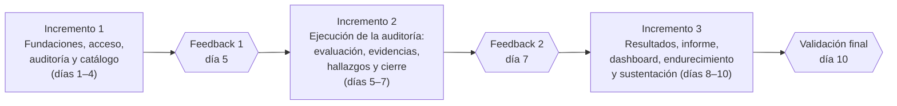

# PLAN DE DESARROLLO — DECR 27000 (AuditSys Mini)

> Plan único para **backend** (`decr27000-backend`) y **frontend** (`decr27000-frontend`), dividido en **3 incrementos** entregables y desplegados. Al final de cada uno se recoge feedback.
> Especificaciones de referencia: `BACKEND_SPEC.md` y `FRONTEND_SPEC.md` (la fuente de verdad es la copia dentro de cada repo). Reglas de trabajo: `CLAUDE.md`.
> Fecha de corte del diagnóstico: 11 de noviembre de 2026 (frontend y entorno revisados de nuevo el 13 de noviembre).
> **Stack decidido**: backend NestJS + Fastify + `pg` (pnpm) · frontend HTML + Tailwind CDN + CSS, sin build · 4 integrantes. Las decisiones están en la sección 6 y el reparto de trabajo en la sección 2.5.
> Este archivo se mantiene igual en los dos repositorios (`PLAN_DESARROLLO.md` en la raíz de cada uno).

---

## 0. Punto de partida (diagnóstico verificado)

| Pieza | Estado actual | Implicación |
| :--- | :--- | :--- |
| Backend en Render (`https://decr27000-backend.onrender.com`) | En línea. Solo `index.js` con `http` nativo: responde `GET /api/health` y `/`. `package.json` sin dependencias. | Hay que construir toda la API. El pipeline de despliegue ya funciona (pnpm). |
| Frontend en Vercel (`https://decr27000-frontend.vercel.app`) | **Actualizado el 13-nov**: las 8 páginas ya están construidas (login, dashboard, auditoría, catálogo, evaluación, hallazgos, informe y 404), con Playwright E2E. Mientras el backend no tenga los endpoints, **funciona con un motor local en `localStorage`** (ver 2.7). | El trabajo pendiente está sobre todo en el backend; el frontend se va conectando al backend real (tareas F-INT). |
| Base de datos Supabase (PostgreSQL 17, Session Pooler) | Existen las 8 tablas (`usuario`, `control`, `auditoria`, `evaluacion_control`, `evidencia`, `hallazgo`, `recomendacion`, `informe`). **No se verificó el contenido.** | Se desconoce si tiene la semilla corregida (ISO 19011:2026 y nombres de controles) y si las contraseñas están hasheadas. Se resuelve en la tarea `B1.3`. |
| Semilla `SEED_93_CONTROLES_Y_EMPRESA_ABC.sql` | Corregida y probada en PostgreSQL 16: 93 controles (37/8/14/34), Empresa ABC con 13 controles, CP-09 da 33,3 % y 54,2 %. | Lista para usar. |
| Especificaciones | Completas: modelo de datos, reglas RN01–RN07, contrato de API, 7 pantallas, CP-01 a CP-13. | Este plan las ordena en el tiempo y añade lo necesario para producción. |

### Riesgos del entorno desplegado (se atienden en el plan)
1. **Supabase expone el esquema `public` por su API REST (PostgREST).** Si RLS está desactivado, cualquiera con la *anon key* del proyecto puede leer y escribir las tablas sin pasar por el backend. → Tarea `B1.4` (obligatoria).
2. **Render (plan gratuito) suspende el servicio tras ~15 min sin tráfico.** La primera petición tarda entre 30 y 60 s. → El frontend muestra un aviso de "despertando servidor" (`F1.3`) y, antes de la sustentación, se hace un ping previo.
3. **Supabase (plan gratuito) pausa el proyecto tras 7 días sin actividad.** → Revisar el panel la semana de la sustentación y mantener tráfico periódico.
4. **`.env.example` público con un `JWT_SECRET` de ejemplo.** → En Render, `JWT_SECRET` debe ser un valor propio (ya lo genera `render.yaml`) y nunca el del ejemplo (`B1.2`).
5. **Producción y demo comparten base de datos.** → Las pruebas automáticas **nunca** corren contra Supabase; usan PostgreSQL en Docker (`B1.10`).

---

## 1. Qué significa "software sólido" en este proyecto

Además de cumplir los criterios de aceptación del curso (sección 17 del documento orientador), el producto debe cumplir estas metas de calidad, alineadas con **ISO/IEC 25010:2023**:

| Característica (ISO/IEC 25010:2023) | Meta verificable |
| :--- | :--- |
| Adecuación funcional | RF01–RF09 completos; CP-01 a CP-13 pasan en automático y en la demo. |
| Fiabilidad | Operaciones de varias tablas en transacción; ningún `500` sin controlar; el health check reporta el estado de la BD. |
| Seguridad | JWT, roles, bloqueo de auditorías cerradas, contraseñas con bcrypt, RLS en Supabase, CORS restringido, límite de intentos de login, cabeceras seguras, salida de datos escapada (sin XSS). |
| Mantenibilidad | Módulos de NestJS (`controller → service → DatabaseService`), TypeScript estricto, DTOs validados, ESLint + Prettier, Swagger, README con instrucciones, commits convencionales. |
| Usabilidad | Flujo guiado de 6 pasos; validación en línea que conserva lo digitado; estado con texto, color e ícono. |
| Flexibilidad (adaptabilidad) | Operable a 360 px; botones de al menos 44 px. |
| Eficiencia de desempeño | Respuesta de la API < 500 ms con el servicio activo; dashboard en una sola consulta agregada; pool de conexiones acotado. |
| Compatibilidad | Funciona en Chrome, Edge, Firefox y Safari actuales. |

---

## 2. Decisiones técnicas transversales

> Cada decisión lleva la opción recomendada. Las que conviene confirmar con el equipo están en la **sección 6 (Preguntas)**. Si no hay respuesta, se aplica la recomendación.

### 2.1. Backend — NestJS + Fastify (decisión del equipo)
- **Framework**: **NestJS 11 con TypeScript y `@nestjs/platform-fastify`**. Fastify es el adaptador más rápido de Nest: rinde aproximadamente el doble de peticiones por segundo que Express y trae el logger `pino` integrado. Esto **reemplaza a Express** de la especificación; el contrato de API (rutas, cuerpos, sobre `{ ok, data | error, field }`) no cambia, así que el frontend no se ve afectado.
- **Proyecto**: se crea con `pnpm dlx @nestjs/cli new decr27000-backend --package-manager pnpm --strict` y se reemplaza el adaptador Express por Fastify.
- **Runtime**: Node.js 22 LTS o superior (fijar en `engines` y en Render).
- **Acceso a datos**: **`pg` con SQL parametrizado, sin ORM**, mediante un `DatabaseModule` global que expone el `Pool` y un helper `withTransaction()`. Es la opción más rápida en ejecución, la semilla SQL sigue siendo la única fuente del esquema, y se mantiene lo que pide la especificación: que se vean las llaves foráneas y los `CHECK` (P1).
- **Validación**: **`class-validator` + `class-transformer` con el `ValidationPipe` global** (`whitelist`, `forbidNonWhitelisted`, `transform`). Es lo nativo de Nest. Un `exceptionFactory` convierte el primer error al formato `{ ok:false, error, field }` (P3).
- **Respuestas y errores**: un `ResponseInterceptor` envuelve las respuestas en `{ ok:true, data, message? }` y un `AllExceptionsFilter` traduce `HttpException` y errores de PostgreSQL (`23505`/`23503` → 409, `23514` → 400) al sobre de error, sin exponer la traza en producción.
- **Seguridad**: `@nestjs/jwt` + `JwtAuthGuard` global (con un decorador `@Public()` para login y health), `RolesGuard` + `@Roles('admin')`, `AuditLockGuard` para auditorías `CERRADA`, `bcryptjs`, `@fastify/helmet`, `@nestjs/throttler` (solo en login) y CORS con lista blanca (P10).
- **Configuración**: `@nestjs/config` con un esquema de validación de variables al arrancar.
- **Documentación de la API**: `@nestjs/swagger` en `/api/docs`. Es la documentación viva del contrato, sirve para probar endpoints en la sustentación y se apaga en producción con una variable si se quiere.
- **Pruebas**: **Jest + supertest** (lo que trae el CLI de Nest, así que no hay que configurar nada): unitarias en los servicios y e2e (`test/*.e2e-spec.ts`) contra PostgreSQL 16 en Docker (P9).
- **Calidad**: ESLint + Prettier (vienen con el CLI); `pnpm lint`, `pnpm test`, `pnpm test:e2e`.
- **Build y despliegue en Render (plan gratuito)**: `buildCommand: pnpm install --frozen-lockfile && pnpm build && pnpm prune --prod` · `startCommand: node --max-old-space-size=384 dist/main.js` (se arranca con `node` directo, sin pasar por `pnpm`, para ahorrar memoria y tiempo de arranque). Fastify debe escuchar en `0.0.0.0` y en `process.env.PORT`. Todas las optimizaciones están en la sección 2.6.

#### Estructura final del backend (reemplaza la sección 2 de `BACKEND_SPEC.md`)
```text
decr27000-backend/
├── package.json · pnpm-lock.yaml · nest-cli.json · tsconfig*.json · .env.example · render.yaml · README.md
├── SEED_93_CONTROLES_Y_EMPRESA_ABC.sql
├── sql/security.sql                      # RLS + REVOKE para Supabase (B1.4)
├── src/
│   ├── main.ts                           # NestFactory con FastifyAdapter, prefijo /api, helmet, CORS, Swagger, pipes globales
│   ├── app.module.ts
│   ├── config/        env.validation.ts
│   ├── database/      database.module.ts · database.service.ts (Pool, query, withTransaction) · init-db.service.ts
│   ├── common/
│   │   ├── decorators/  public.decorator.ts · roles.decorator.ts · current-user.decorator.ts
│   │   ├── guards/      jwt-auth.guard.ts · roles.guard.ts · audit-lock.guard.ts
│   │   ├── filters/     all-exceptions.filter.ts      # sobre { ok:false, error, field }
│   │   ├── interceptors/response.interceptor.ts       # sobre { ok:true, data }
│   │   └── utils/       codes.ts (H-nn / EV-nn) · pg-errors.ts
│   └── modules/
│       ├── health/        GET /api/health (con estado de la BD)
│       ├── auth/          login, me, estrategia JWT
│       ├── usuarios/
│       ├── controles/     catálogo de 93 controles + edición solo para admin
│       ├── auditorias/    CRUD + máquina de estados (auditoria-estado.service.ts) + selección de controles
│       ├── evaluaciones/
│       ├── evidencias/
│       ├── hallazgos/     hallazgos + recomendaciones
│       ├── indicadores/   RF07 (lo usan dashboard e informes)
│       ├── dashboard/
│       ├── informes/      8 secciones, versiones, snapshot
│       └── seed/          POST /api/seed/reset (protegido)
│       # cada módulo: *.module.ts · *.controller.ts · *.service.ts · dto/*.dto.ts
└── test/
    ├── helpers/ test-db.ts (BD desechable en Docker + semilla) · auth.ts (tokens)
    └── cp-01..cp-13.e2e-spec.ts
```

### 2.2. Frontend — HTML + Tailwind + CSS (decisión del equipo)
- **Arquitectura**: MPA con **HTML5 + Tailwind + CSS propio**. Solo se usa **Vanilla JS (módulos ES6) sin framework**, y únicamente para lo que HTML/CSS no pueden hacer: llamar a la API, validar en línea, guardar la sesión y dibujar los gráficos. No hay React, Vue ni bundler de JS.
- **Estilos (decidido, P4: "algo muy simple")**: **sin paso de build**. Cada página HTML carga Tailwind desde CDN con **versión exacta** (`<script src="https://cdn.jsdelivr.net/npm/@tailwindcss/browser@4.3.5"></script>`) y una sola hoja propia `css/styles.css` escrita a mano con:
  - las **variables de la paleta oficial** en `:root` (`--color-primary: #003366`, `--color-accent: #00C6D0`, `--color-ok: #2E9E5B`, `--color-partial: #F2A900`, `--color-ko: #D64545`, `--color-na: #8A98A3`, `--color-pending: #64748B`);
  - las clases de componentes reutilizables en CSS plano (`.btn`, `.btn-primary`, `.chip`, `.chip-implementado`, `.badge-alta`, `.card`, `.field-error`…);
  - las reglas de `@media print` para el informe.
  - Tailwind se usa para *layout* y espaciado (`grid`, `flex`, `gap-4`, `md:grid-cols-2`); los colores de marca salen de las clases propias o de `bg-[var(--color-primary)]`. Vercel sirve los archivos tal cual, sin `pnpm build`.
- **Librerías por CDN con versión exacta**: Chart.js `4.6.1` (`https://cdn.jsdelivr.net/npm/chart.js@4.6.1/dist/chart.umd.min.js`) y html2pdf.js `0.14.0` (`https://cdn.jsdelivr.net/npm/html2pdf.js@0.14.0/dist/html2pdf.bundle.min.js`). Antes de fijarlas, comprobar que sigan siendo estables.
- **Integridad de los CDN (SRI)**: cada `<script>` externo lleva `integrity="sha384-…"` y `crossorigin="anonymous"`, con el hash que publica jsDelivr para esa versión exacta. Así, si el CDN sirve un archivo alterado, el navegador no lo ejecuta.
- **Sesión (decidido, P5)**: JWT en `localStorage` (`auditsys_token`, `auditsys_user`) con expiración de 8 h. Al recibir `401`, se borra y se redirige al login.
- **Seguridad**: los datos del usuario se pintan con `textContent` o con el helper `escapeHtml()`. Prohibido usar `innerHTML` con datos de la API. Se añaden cabeceras en `vercel.json` (`X-Content-Type-Options`, `Referrer-Policy`, `X-Frame-Options`, y una CSP que permite `cdn.jsdelivr.net` y `'unsafe-inline'` en estilos, porque Tailwind para navegador inyecta estilos en tiempo de ejecución).
- **PDF (decidido, P7)**: impresión nativa (`window.print()` + `@media print`) como opción principal ("Imprimir / Guardar como PDF") y html2pdf como botón secundario ("Descargar PDF").
- **pnpm en el frontend**: solo para herramientas de desarrollo (`pnpm lint`, `pnpm test:e2e`, `pnpm dev` = servidor estático local con `pnpm dlx serve .`). La app desplegada no depende de ningún paquete de pnpm.
- **Pruebas**: **Playwright** con escenarios E2E de CP-01 a CP-13, más un perfil móvil de 360 px (CP-12) (P9).
- **Calidad**: ESLint + Prettier; `pnpm lint`.

#### Estructura final del frontend (amplía la sección 2 de `FRONTEND_SPEC.md`)
```text
decr27000-frontend/
├── package.json · pnpm-lock.yaml   # solo devDependencies: eslint, prettier, @playwright/test
├── vercel.json · README.md
├── index.html · login.html · dashboard.html · auditoria.html · catalogo.html
├── evaluacion.html · hallazgos.html · informe.html   # cada una carga Tailwind CDN + css/styles.css
├── css/styles.css               # escrita a mano: variables de paleta, componentes y @media print
├── js/
│   ├── config.js · api.js · auth.js · layout.js · validators.js · ui.js (toast, modal, escapeHtml, loaders)
│   ├── format.js                # fechas y porcentajes en es-CO (coma decimal)
│   └── pages/  dashboard.js · auditoria.js · catalogo.js · evaluacion.js · hallazgos.js · informe.js
└── e2e/  playwright.config.js · cp-01..cp-13.spec.js
```

### 2.3. Flujo de trabajo del equipo
- **Ramas**: `main` protegida (solo por PR); ramas `feat/...`, `fix/...`, `docs/...`. Cada PR del frontend genera un *preview* en Vercel para revisarlo antes de fusionar (P11).
- **PR**: descripción con el RF/CP que cubre, captura o enlace al *preview* y checklist de la DoD. Al menos una revisión de otro integrante (de preferencia, el par del mismo repo; ver 2.5).
- **Commits**: en inglés con Conventional Commits, sin `Co-Authored-By` (ver `CLAUDE.md`).
- **Gestor de paquetes**: **pnpm** siempre.
- **Entornos**:

| Entorno | Backend | Base de datos | Frontend |
| :--- | :--- | :--- | :--- |
| Local | `pnpm start:dev` (Nest en modo watch, puerto 4000) | **Supabase** (el mismo proyecto; `.env` local del backend, ignorado por git). Docker es opcional para trabajar sin conexión. | servidor estático local → `http://localhost:4000/api` |
| Pruebas automáticas | Jest + supertest (`pnpm test`, `pnpm test:e2e`) | PostgreSQL 16 en Docker (BD desechable) | Playwright contra local |
| Producción / demo | Render | Supabase | Vercel |

### 2.4. Definición de Terminado (DoD) para cualquier tarea
1. Cumple el criterio de aceptación del RF/CP (matriz de la sección 5).
2. Valida en cliente **y** en servidor, con mensajes claros en español bajo el campo.
3. Persiste los datos y mantiene la trazabilidad (llaves foráneas y transacciones).
4. Tiene al menos una prueba automática positiva y una negativa.
5. `pnpm lint` y `pnpm test` pasan; el PR fue revisado y fusionado en `main`.
6. Está desplegado (Render/Vercel) y se puede demostrar con Empresa ABC.

### 2.5. Equipo de 4 integrantes y reparto (decidido, P13)

> ⚠️ **Confirmar con el profesor**: el documento orientador dice *"Grupos de dos o tres estudiantes; máximo tres integrantes"*. Con 4 integrantes conviene pedir autorización por escrito antes del día 1. Si no la dan, se pasa al reparto de 3 roles que propone el curso (sección 11 del documento orientador).

Reparto en **dos parejas por repositorio**: cada persona es dueña de un bloque completo (y lo sustenta) y revisa los PR de su par.

| Rol | Repo | Responsabilidad principal | I1 | I2 | I3 | Entregables a cargo |
| :--- | :--- | :--- | :--- | :--- | :--- | :--- |
| **Integrante 1 — Backend plataforma** | backend | Base de Nest + Fastify, configuración, BD, seguridad, autenticación y ciclo de vida de la auditoría | B1.0–B1.8, B1.10 (su parte) | B2.4 (reglas de transición), revisión de seguridad de las rutas nuevas | B3.4, B3.5, despliegue final en Render | 1. Modelado (arquitectura y modelo ER) |
| **Integrante 2 — Backend proceso auditor** | backend | Catálogo, evaluación, evidencias, hallazgos, trazabilidad, indicadores e informes | B1.9 + sus pruebas | B2.1, B2.2, B2.3, B2.5, B2.6 | B3.1, B3.2, B3.3, B3.6 | 1. Modelado (casos de uso) · 6. Informe de auditoría (datos) |
| **Integrante 3 — Frontend base y resultados** | frontend | Plantilla y CSS, núcleo JS, login, layout, auditoría, dashboard e informe | F1.1–F1.6 | F2.3 (ciclo de vida) + apoyo a F2.1 | F3.1, F3.2, F3.3 | 2. Prototipos · 6. Informe de auditoría (PDF) |
| **Integrante 4 — Frontend ejecución y calidad** | frontend | Catálogo, evaluación, hallazgos, pruebas E2E y pulido | F1.7 | F2.1, F2.2 | F3.4, F3.5 | 5. Informe de pruebas · 7. Guion de sustentación |

Reglas del reparto:
- **Revisión cruzada**: Integrante 1 ↔ 2 en el backend; Integrante 3 ↔ 4 en el frontend. Una vez por incremento, cada pareja revisa un PR de la otra para que todos conozcan el flujo completo (lo exige el curso).
- **Contrato primero**: antes de construir una pantalla, el par backend–frontend del bloque acuerda el endpoint con Swagger (`/api/docs`) y lo prueba con datos de Empresa ABC.
- **Día 1**: Integrante 1 deja listo el módulo de referencia (`controles` + guard + DTO + prueba e2e) e Integrante 3 la plantilla HTML con `styles.css`. Los demás copian esos patrones.
- **Sustentación**: cada integrante demuestra su bloque y responde por el flujo completo (Pasos 1–8 de FRONTEND_SPEC §7.3).

### 2.6. Optimización para Render gratuito + Supabase

Render gratuito ofrece **512 MB de RAM y 0,1 de CPU**, **suspende el servicio tras 15 min sin tráfico** y la primera petición tarda entre 30 y 60 s. Supabase está en `us-east-2` (Ohio). Cada punto apunta a gastar menos memoria y CPU, arrancar más rápido y hacer menos viajes a la base:

| # | Optimización | Cómo | Ganancia |
| :---: | :--- | :--- | :--- |
| O1 | **Misma región** para Render y Supabase | En Render, servicio en **Ohio** (`region: ohio`). Si hoy está en otra región, recrearlo en Ohio (la región no se puede cambiar después de creado). | Cada consulta pasa de ~40–70 ms a ~1–5 ms de red. Es la mejora más grande. |
| O2 | **Fastify + `pg` directo** | Ya decidido (2.1). Sin ORM, sin Express. | Menos memoria y CPU por petición; arranque más rápido. |
| O3 | **Arrancar con `node`, no con `pnpm`** | `startCommand: node --max-old-space-size=384 dist/main.js`. | Se ahorra el proceso extra de pnpm (~40–60 MB) y el heap queda por debajo de 512 MB. |
| O4 | **Solo dependencias de producción** | `pnpm prune --prod` al final del build. Compilar con `nest build` (tsc), sin webpack. | Menos memoria y un arranque en frío más corto. |
| O5 | **Pool pequeño y persistente** | `max: 4`, `keepAlive: true`, `idleTimeoutMillis: 30000`, conexión por el **Session Pooler** (puerto 5432). Crear el pool una vez al arrancar y reutilizarlo. | Evita agotar las conexiones del plan gratuito de Supabase y repetir el handshake TLS (~1 s medido desde local). |
| O6 | **Caché en memoria del catálogo** | Los 93 controles se leen una vez y se guardan en memoria; se invalidan cuando el admin edita uno. `GET /api/controles` responde con `ETag` y `Cache-Control: private, max-age=300`. | El endpoint más pesado (~66 KB) deja de ir a la BD en cada carga. |
| O7 | **Una consulta por pantalla** | Dashboard e indicadores con una sola consulta agregada; evaluaciones con evidencias y hallazgos en 3 consultas en total (sin N+1); `json_agg` cuando convenga. | Menos viajes a la BD, que son lo más caro. |
| O8 | **Arranque liviano** | Al iniciar solo se verifica `SELECT COUNT(*) FROM control`; la semilla nunca corre en cada arranque. Swagger se registra solo si `SWAGGER_ENABLED=true`. Logger de Fastify en nivel `warn` en producción. | El servicio despierta más rápido tras la suspensión. |
| O9 | **Health check barato** | `GET /api/health` responde sin tocar la BD; `GET /api/health?db=1` hace el `SELECT 1`. Render usa el primero. | Render no gasta conexiones a la BD en sus chequeos. |
| O10 | **Evitar la suspensión** (opcional) | Un monitor externo gratuito (UptimeRobot o cron-job.org) llama a `/api/health` cada 10 min en horario de trabajo y el día de la sustentación. Un solo servicio 24/7 consume ~744 h de las 750 h gratuitas del mes. | Sin arranques en frío durante la demo. |
| O11 | **Respuestas pequeñas** | Solo los campos que usa la pantalla; sin `SELECT *` en listados; `bodyLimit` de 100 KB. | Menos CPU de serialización y menos ancho de banda. |
| O12 | **Apagado limpio** | `enableShutdownHooks()` cierra el pool cuando Render suspende o redespliega. | No quedan conexiones colgadas en Supabase. |

> Las pruebas automáticas (Jest + supertest) siguen corriendo contra PostgreSQL en Docker, **nunca contra Supabase**, porque producción, demo y desarrollo local comparten la misma base.

### 2.7. Modo local del frontend (`js/seed-data.js`) y conexión con el backend real

**Estado verificado (13-nov-2026)**: el frontend ya está construido, pero **todo lo que muestra sale de `localStorage`** (`auditsys_local_db_v1`), no de Supabase. `js/api.js` cae a un motor local (`js/seed-data.js`) en tres casos:
1. si el modo es `local`;
2. si el backend responde `404` con `"Ruta no encontrada"`, que es lo que devuelve hoy el `index.js` provisional para todo menos `/api/health`;
3. si hay un error de red y el modo no es `remote-strict`.

En ese modo el login acepta la clave fija `Audit2026*`, devuelve un token falso (`demo-jwt-token-…`) y guarda auditorías, evidencias y hallazgos en el navegador de cada persona.

Tareas de integración (se van cerrando a medida que el backend Nest publica endpoints):
- [ ] **F-INT.1** Cuando un endpoint exista en el backend, comprobarlo con el modo `remote-strict` (selector en `login.html`) para que no caiga al motor local.
- [ ] **F-INT.2** Al terminar el I2, quitar la caída automática por errores de red (caso 3): un error de red debe mostrarse como error, no guardar datos en `localStorage` en silencio, porque si no, los datos de la auditoría se dividen entre Supabase y el navegador.
- [ ] **F-INT.3** Antes de la sustentación, dejar `remote-strict` como modo por defecto y conservar el modo `local` solo como opción manual de respaldo (documentada) si Render o Supabase fallan.
- [ ] **F-INT.4** Cambiar en `package.json` los scripts `npx serve` por `serve . -l 3000` (el paquete ya está en `devDependencies`), según la regla "solo pnpm".

---

## 3. Vista general de los incrementos



| Incremento | Requisitos | Casos de prueba | Resultado desplegado |
| :--- | :--- | :--- | :--- |
| **I1** Fundaciones | RF01, RF02, RNF02, RNF03, RNF04, RNF06 | CP-01, CP-02, CP-03, CP-13 (catálogo) | Login, layout, crear/editar auditoría, catálogo de 93 controles y selección de 10–15. |
| **I2** Ejecución | RF03, RF04, RF05, RF06, RNF05 | CP-04, CP-05, CP-06, CP-07, CP-08, CP-13 (auditoría cerrada) | Evaluar controles, registrar evidencias y hallazgos con recomendaciones, matriz de trazabilidad, transiciones hasta `CERRADA`. |
| **I3** Resultados y calidad | RF07, RF08, RF09, RNF01 | CP-09, CP-10, CP-11, CP-12 + regresión completa | Indicadores, informe de 8 secciones con versiones y PDF, dashboard con gráficos, endurecimiento, pruebas E2E y entregables. |

---

## 4. Detalle por incremento

### INCREMENTO 1 — Fundaciones, acceso, auditoría y catálogo (días 1–4)

**Objetivo**: dejar la base técnica completa y segura, más el primer tramo del flujo (paso 1 → paso 3 del stepper), desplegado y demostrable.

#### Backend
- [ ] **B1.0 Actualizar documentación al nuevo stack**: en `BACKEND_SPEC.md` reemplazar Express por NestJS + Fastify (secciones 1, 2, 2.1, 7 y la nota de CORS), y en `CLAUDE.md` ajustar los comandos. El contrato de API (sección 6) se mantiene igual.
- [ ] **B1.1 Proyecto base NestJS + Fastify**
  - Crear el esqueleto con `pnpm dlx @nestjs/cli new` (TypeScript estricto, pnpm) en una rama, conservando la semilla, `.env.example`, `.gitignore` y la documentación del repo. Eliminar el `index.js` actual.
  - `pnpm add @nestjs/platform-fastify @fastify/helmet @nestjs/config @nestjs/jwt @nestjs/passport passport passport-jwt @nestjs/throttler @nestjs/swagger class-validator class-transformer pg bcryptjs`
  - `pnpm add -D @types/pg @types/bcryptjs @types/passport-jwt` (Jest y supertest ya vienen con el CLI).
  - `main.ts`: `NestFactory.create<NestFastifyApplication>(AppModule, new FastifyAdapter({ logger: true }))`, `setGlobalPrefix('api')`, helmet, CORS, `ValidationPipe` global, `AllExceptionsFilter`, `ResponseInterceptor`, Swagger en `/api/docs`, `listen(PORT, '0.0.0.0')`, `enableShutdownHooks()`.
  - `"engines": { "node": ">=22" }`; scripts `build`, `start:dev`, `start:prod`, `lint`, `test`, `test:e2e`, `db:seed`, `db:security`.
  - `render.yaml`: `plan: free`, `region: ohio` (igual que Supabase `us-east-2`), `buildCommand: pnpm install --frozen-lockfile && pnpm build && pnpm prune --prod`, `startCommand: node --max-old-space-size=384 dist/main.js`, `healthCheckPath: /api/health` (ver 2.6).
- [ ] **B1.2 Configuración y entorno** (`config/env.validation.ts` con `@nestjs/config`)
  - Validar todas las variables al arrancar (`DATABASE_URL`, `JWT_SECRET` de 32 caracteres o más, `JWT_EXPIRES_IN`, `CORS_ORIGINS`, `NODE_ENV`, `ALLOW_SEED_RESET`, `SWAGGER_ENABLED`). Si falta alguna, la app no arranca y lo dice claramente.
  - En producción, rechazar el arranque si `JWT_SECRET` es igual al de `.env.example`.
  - Actualizar `.env.example` con las variables nuevas (solo marcadores).
- [ ] **B1.3 Base de datos y semilla** (`database/`)
  - `DatabaseService` global: `Pool` con SSL para Supabase (Session Pooler), `max: 4`, `idleTimeoutMillis: 30000`, `connectionTimeoutMillis: 10000`, `keepAlive: true`, métodos `query<T>()` y `withTransaction(fn)`. Cierra el pool en `onModuleDestroy`. Ver 2.6.
  - `InitDbService` + script `pnpm db:seed` (`node dist/database/seed.js`): ejecuta la semilla y hashea con bcrypt (coste 10) toda contraseña que no empiece por `$2`.
  - Al arrancar: si `control` no existe o tiene menos de 93 filas, inicializa la BD. **Nunca** reinicia una BD que ya tiene datos.
  - **Verificación en Supabase** (una sola vez, con aprobación del equipo): contar controles, revisar `referentes` y el nombre del control 7.7, y comprobar que `password_hash` empiece por `$2`. Si tiene la semilla anterior, volver a sembrar con la corregida.
- [ ] **B1.4 Seguridad de Supabase** (`sql/security.sql`, `pnpm db:security`)
  - `ALTER TABLE … ENABLE ROW LEVEL SECURITY` en las 8 tablas, sin políticas. El backend se conecta como dueño de las tablas y no se ve afectado.
  - `REVOKE ALL ON ALL TABLES IN SCHEMA public FROM anon, authenticated;` y lo mismo para secuencias.
  - Verificar que el panel de Supabase ya no muestre la alerta "RLS disabled".
- [ ] **B1.5 Infraestructura HTTP** (`common/`)
  - `@fastify/helmet`; CORS con lista blanca (`FRONTEND_URL`, `https://*.vercel.app` del proyecto, `http://localhost:*`); `bodyLimit` de Fastify en 100 KB; logger pino de Fastify con id por petición.
  - `AllExceptionsFilter`: traduce `HttpException`, errores del `ValidationPipe` y errores de PostgreSQL (`23505` → 409, `23503` → 409, `23514` → 400) al sobre `{ ok:false, error, field? }`. Nunca expone la traza en producción. Las rutas inexistentes también responden 404 con ese formato.
  - `ResponseInterceptor`: envuelve las respuestas en `{ ok:true, data, message? }`.
  - `HealthModule` (`@Public()`): `GET /api/health` → `{ ok, status, service, timestamp }` sin tocar la BD (es el que usa Render); `GET /api/health?db=1` agrega `db: "UP|DOWN"` con un `SELECT 1` (ver O9 en 2.6).
- [ ] **B1.6 Autenticación y roles** (RNF04, `modules/auth`, `modules/usuarios`)
  - `POST /api/auth/login` (`@Public()`) con `@Throttle` de 10 intentos cada 15 min por IP y mensaje genérico ("Credenciales inválidas").
  - `GET /api/auth/me` y `GET /api/usuarios` (sin `password_hash`).
  - `JwtAuthGuard` global (`401` si falta o expiró) + `RolesGuard` con `@Roles('admin')` (`403`) + decorador `@CurrentUser()`.
  - JWT con `sub`, `rol` y `nombre`; expiración `8h` (P5).
- [ ] **B1.7 Auditorías** (RF01, RN01, CP-01, CP-02)
  - `GET /api/auditorias` (con métricas resumidas), `GET /api/auditorias/:id`, `POST`, `PUT`.
  - DTOs con `class-validator`: obligatorios, longitudes (`organizacion` ≤ 120), `@IsDateString()` y un validador propio para `fecha_fin >= fecha_inicio` con `field: "fecha_fin"`.
  - Toda auditoría nueva nace en `BORRADOR`; `referentes` usa por defecto `ISO 19011:2026; ISO/IEC 27001:2022; ISO/IEC 27002:2022`.
  - `AuditLockGuard`: resuelve la auditoría a partir de `:id`, `:id_evaluacion`, `:id_evidencia`, `:id_hallazgo` o `:id_recomendacion` y responde `403` ante cualquier mutación sobre una auditoría `CERRADA` (se reutiliza en I2).
- [ ] **B1.8 Máquina de estados** (`modules/auditorias/auditoria-estado.service.ts`)
  - Transiciones permitidas: `BORRADOR → EN_EJECUCION → EN_REVISION → CERRADA`, más retroceso `EN_REVISION → EN_EJECUCION`. `CERRADA` es definitivo.
  - En I1 se implementa la regla RN02 (10–15 controles para pasar a `EN_EJECUCION`). Las reglas RN04 y RN06 se agregan en I2 sobre la misma función.
  - `PATCH /api/auditorias/:id/estado`.
- [ ] **B1.9 Catálogo y selección** (RF02, RN02, CP-03, CP-13)
  - `GET /api/controles?categoria=&q=`: búsqueda insensible a mayúsculas y acentos (`unaccent` si está disponible; si no, normalizar en JS). Orden numérico por código.
  - `POST /api/controles` y `PUT /api/controles/:id` solo para `admin`; para `auditor`, `403` con el mensaje oficial.
  - `PUT /api/auditorias/:id/seleccion-controles`: valida 10–15 IDs únicos y existentes; sincroniza en una transacción (borra los quitados, inserta los nuevos en `PENDIENTE`, conserva los existentes); pasa `BORRADOR → EN_EJECUCION`. Si un control que se quita ya tiene evidencias o hallazgos, responde `409` explicando por qué (protege la trazabilidad).
  - `GET /api/auditorias/:id/evaluaciones` (versión base: lista con estado; I2 agrega evidencias y hallazgos anidados).
- [ ] **B1.10 Pruebas y documentación**
  - `test/helpers/test-db.ts`: crea una BD desechable en Docker, ejecuta la semilla y la limpia; `test/helpers/auth.ts` genera tokens de auditor y admin.
  - Pruebas e2e (Jest + supertest sobre `app.getHttpAdapter().getInstance()` de Fastify): login correcto e incorrecto, `401` sin token, CP-01, CP-02, CP-03 (9, 16 y 13 controles), CP-13 (auditor edita catálogo → 403).
  - Pruebas unitarias de `AuditoriaEstadoService` (transiciones válidas e inválidas).
  - `README.md`: requisitos, `.env`, comandos pnpm, cómo levantar PostgreSQL en Docker y enlace a Swagger (`/api/docs`).

#### Frontend
- [ ] **F1.1 Proyecto base (sin build)**
  - Plantilla HTML común (`<head>` con meta viewport, Tailwind CDN `@tailwindcss/browser@4.3.5` con `integrity` + `crossorigin`, `css/styles.css` y `<script type="module">` de la página) que se copia en las 8 páginas.
  - `package.json` con pnpm **solo para desarrollo**: `pnpm dev` (`pnpm dlx serve .`), `pnpm lint` (ESLint + Prettier) y `pnpm test:e2e` (Playwright, en I3).
  - `vercel.json` sin `buildCommand` (sitio estático) y con cabeceras de seguridad (CSP compatible con el CDN, `X-Content-Type-Options`, `Referrer-Policy`, `X-Frame-Options`).
  - `css/styles.css`: variables de la paleta oficial (`#003366`, `#00C6D0`, `#2E9E5B`, `#F2A900`, `#D64545`, `#8A98A3`, `#64748B`) y componentes base en CSS plano: botón (mínimo 44 px), chip de estado (texto + color + ícono), badge de severidad, tarjeta, tabla responsiva, campo con error.
- [ ] **F1.2 Núcleo JS**
  - `config.js` (resolución de `API_BASE_URL` según la especificación).
  - `api.js`: `fetch` centralizado con JWT, tiempo de espera de 70 s (por el arranque en frío de Render), traducción del sobre `{ok,error,field}`, `401` → cierre de sesión y redirección, `403` → aviso rojo.
  - `auth.js`: protege las páginas privadas y expone el usuario y su rol.
  - `ui.js`: toast, modal de confirmación, `escapeHtml`, estados de carga y vacío.
  - `validators.js`: obligatorios, longitudes y fechas; muestra el error bajo el campo sin borrar lo digitado; acepta errores `field` del backend.
  - `format.js`: fechas `dd/mm/aaaa` y porcentajes con coma decimal.
- [ ] **F1.3 Login** (`login.html`, `index.html` redirige)
  - Formulario con validación, botones de acceso rápido (Auditora / Admin), acordeón para la URL de la API.
  - Aviso "Despertando el servidor (puede tardar hasta 1 minuto)…" cuando el health check tarda más de 3 s.
- [ ] **F1.4 Layout compartido** (`layout.js`)
  - Sidebar plegable (hamburguesa en móvil), header con selector global de auditoría activa, badge de estado, botón "+ Nueva Auditoría", stepper de 6 pasos con el paso actual resaltado y usuario con su rol y botón de cerrar sesión.
- [ ] **F1.5 Dashboard provisional** (`dashboard.html`): tabla de auditorías con estado y acciones (abrir, editar). Los KPI y gráficos llegan en I3.
- [ ] **F1.6 Auditoría** (`auditoria.html`, CP-01, CP-02)
  - Modo `?mode=new` y modo edición; selector de auditor desde `GET /api/usuarios`; referentes prellenados.
  - Panel de ciclo de vida con los botones de transición válidos según el estado y los mensajes del backend.
  - Auditoría `CERRADA`: todo deshabilitado y aviso de inmutabilidad.
- [ ] **F1.7 Catálogo** (`catalogo.html`, CP-03, CP-13)
  - Barra fija con contador "X de 10 a 15", badge rojo o verde y botón "Guardar selección y continuar".
  - Búsqueda instantánea (con *debounce*), pestañas por categoría con conteos (93/37/8/14/34/seleccionados).
  - Tarjetas con interruptor "En auditoría"; botón "Cargar selección sugerida Empresa ABC (13)".
  - Modal "Editar criterio": el admin guarda; el auditor ve el `403` en rojo (demostración de CP-13).

#### Criterios de salida del I1 (checklist del día 5 del curso)
- [ ] Se crea una auditoría y sigue ahí después de recargar (CP-01, RNF02).
- [ ] El catálogo muestra los 93 controles y permite seleccionar entre 10 y 15 (CP-03).
- [ ] La BD tiene llaves foráneas, `CHECK`, RLS activo y contraseñas con bcrypt.
- [ ] La autenticación funciona y está documentada; el auditor no edita el catálogo (CP-13).
- [ ] Los dos repos tienen README con instrucciones.
- [ ] Desplegado en Render y Vercel; las pruebas automáticas del I1 pasan.

#### Demo y feedback 1
1. Login con los dos roles → crear "Empresa XYZ" con fecha de cierre vacía (CP-02) → corregir y guardar (CP-01).
2. Catálogo: 9 controles (bloqueo), 16 (bloqueo), 13 (pasa a `EN_EJECUCION`).
3. Como auditor, editar un control (403).

**Preguntas para el feedback**: ¿el stepper y el selector de auditoría se entienden? ¿Faltan filtros en el catálogo? ¿Los mensajes de validación son claros?

---

### INCREMENTO 2 — Ejecución de la auditoría (días 5–7)

**Objetivo**: completar el corazón del proceso auditor (pasos 4 y 5 del stepper) con trazabilidad de punta a punta y el ciclo de vida completo hasta `CERRADA`.

#### Backend
- [ ] **B2.1 Evaluaciones** (RF03, RN03, CP-04, CP-05)
  - `GET /api/auditorias/:id/evaluaciones` completo: datos del control, evidencias, hallazgos con recomendaciones y `requiere_evidencia_faltante`, todo en pocas consultas (sin N+1).
  - `PUT /api/evaluaciones/:id`: observación obligatoria; justificación obligatoria si `NO_APLICABLE` (`@ValidateIf`); limpiar `justificacion_na` al cambiar de estado; actualizar `actualizado_en`. Protegido con `AuditLockGuard`.
- [ ] **B2.2 Evidencias** (RF04, CP-06)
  - `POST /api/evaluaciones/:id/evidencias`: DTO (descripción, fuente, fecha no futura, referencia opcional, `es_simulada` por defecto `true`); `EV-nn` = máximo + 1 por auditoría, dentro de la transacción.
  - `DELETE /api/evidencias/:id`. Los dos con `AuditLockGuard`.
- [ ] **B2.3 Hallazgos y recomendaciones** (RF05, RF06, RN05, CP-07)
  - `GET /api/auditorias/:id/hallazgos` con control asociado y recomendaciones.
  - `POST /api/evaluaciones/:id/hallazgos` con la recomendación inicial opcional en la **misma transacción**; `H-nn` = máximo + 1 por auditoría; reintento ante colisión.
  - `PUT` y `DELETE /api/hallazgos/:id`; `POST /api/hallazgos/:id/recomendaciones`; `PUT` y `DELETE /api/recomendaciones/:id` (el `PUT` de recomendaciones es nuevo frente a la especificación).
  - Regla: no se puede eliminar la última recomendación de un hallazgo si la auditoría está `EN_REVISION` (evita romper RN06 justo antes del cierre).
- [ ] **B2.4 Reglas de transición completas** (RN04, RN06, CP-06, CP-08)
  - `→ EN_REVISION`: sin `PENDIENTE` y todo `IMPLEMENTADO`/`PARCIAL` con evidencia. Si falla, responde con la lista de `codigo_iso` que incumplen.
  - `→ CERRADA`: lo anterior, más 3 hallazgos como mínimo y cada uno con al menos una recomendación. El error indica qué falta exactamente.
  - Endpoint de apoyo `GET /api/auditorias/:id/verificacion-cierre`, que devuelve el checklist (`{ pendientes, sin_evidencia, total_hallazgos, hallazgos_sin_recomendacion, puede_revisar, puede_cerrar }`) para que el frontend lo muestre en vivo.
- [ ] **B2.5 Trazabilidad** (RNF05): `GET /api/auditorias/:id/trazabilidad` con la consulta oficial.
- [ ] **B2.6 Pruebas**: CP-04, CP-05, CP-06, CP-07, CP-08 (con 2 hallazgos, y con un hallazgo sin recomendación), CP-13 (cualquier mutación sobre una auditoría `CERRADA` → 403), consecutivos `H-nn`/`EV-nn` después de borrar.

#### Frontend
- [ ] **F2.1 Evaluación** (`evaluacion.html`, CP-04, CP-05, CP-06)
  - Maestro-detalle: lista de los 10–15 controles con chip de estado, íconos de evidencia, hallazgo y alerta, y barra de progreso "X de N evaluados".
  - Panel del control: criterio, pregunta orientadora, ejemplo y evidencia sugerida; selector de 4 estados (tarjetas de 44 px o más); observación; justificación N/A que aparece sola con el aviso "se excluye del denominador".
  - Subpanel de evidencias: lista con el badge "Simulada"; formulario rápido; banner RN04 si falta evidencia; borrar con confirmación.
  - Botón "Registrar hallazgo para este control" (abre el modal compartido con `hallazgos.html`).
  - Navegación con teclado (↑/↓ entre controles) y aviso de cambios sin guardar.
- [ ] **F2.2 Hallazgos** (`hallazgos.html`, CP-07, CP-08)
  - Panel de reglas de cierre en vivo (desde `verificacion-cierre`): "Hallazgos: X (mínimo 3)", "Con recomendación: X / X", "Controles sin evidencia: …".
  - Formulario: control asociado (prellena el `criterio` con el texto del catálogo), severidad, condición, causa, efecto y riesgo, y bloque de recomendación inicial.
  - Tarjetas `H-nn` con las 4 partes del hallazgo y sus recomendaciones; agregar, editar y eliminar.
  - Matriz de trazabilidad: tabla Auditoría → Control → Estado → EV-nn → H-nn → Recomendación, con filtros "sin evidencia" y "hallazgo sin recomendación".
- [ ] **F2.3 Ciclo de vida**: botones "Enviar a revisión" y "Cerrar auditoría" en `auditoria.html` y `hallazgos.html`, con confirmación y con el detalle exacto del backend si se rechaza.

#### Criterios de salida del I2
- [ ] Se completa en el sistema la auditoría de Empresa ABC (13 controles, 12 evidencias, 4 hallazgos, 4 recomendaciones) desde una auditoría nueva.
- [ ] CP-04 a CP-08 y CP-13 (cerrada) pasan en automático y en la UI.
- [ ] La matriz de trazabilidad no deja ningún control sin explicar.
- [ ] Desplegado.

#### Demo y feedback 2
1. Evaluar: `PARCIAL` sin observación (CP-04); 8.31 `NO_APLICABLE` sin justificación (CP-05); 5.1 `IMPLEMENTADO` sin evidencia e intentar enviar a revisión (CP-06).
2. Hallazgo sin causa (CP-07) → completo, genera `H-05`.
3. Intentar cerrar con un hallazgo sin recomendación (CP-08) → corregir → cerrar → intentar editar (CP-13).

**Preguntas para el feedback**: ¿la pantalla de evaluación está cargada de más en móvil? ¿El texto heredado del criterio ayuda o estorba? ¿Hace falta editar evidencias además de borrarlas?

---

### INCREMENTO 3 — Resultados, informe, dashboard, endurecimiento y sustentación (días 8–10)

**Objetivo**: generar los resultados desde la BD, cerrar la calidad (pruebas, seguridad, móvil) y dejar listos los entregables y la demo.

#### Backend
- [ ] **B3.1 Indicadores** (RF07, CP-09): `GET /api/auditorias/:id/indicadores` con la consulta oficial, más las fórmulas como texto (`"(4 / 12) × 100"`) para que el informe las muestre sin recalcular.
- [ ] **B3.2 Dashboard** (RF09, CP-11): `GET /api/dashboard?id_auditoria=` con una consulta agregada; los números deben coincidir exactamente con los del informe. Agregar `auditorias_recientes`.
- [ ] **B3.3 Informes** (RF08, CP-10)
  - `GET /api/auditorias/:id/informes`: las 8 secciones en vivo más el historial de versiones.
  - `POST /api/auditorias/:id/informes`: `version = MAX + 1` en transacción; guarda `snapshot_json` completo y el resumen ejecutivo generado.
  - `GET /api/informes/:id_informe`: devuelve una versión congelada (para reabrir un informe histórico tal como se generó).
  - Texto de limitaciones obligatorio (no constituye certificación ISO/IEC 27001).
- [ ] **B3.4 Restauración de la demo**: `POST /api/seed/reset` solo para `admin`, solo si `ALLOW_SEED_RESET=true` y con el cuerpo `{ "confirm": "RESTAURAR-EMPRESA-ABC" }` (P6). Después vuelve a aplicar `security.sql`.
- [ ] **B3.5 Endurecimiento**
  - Revisar que **todas** las rutas de mutación tengan `JwtAuthGuard`, `AuditLockGuard` y un DTO validado (una prueba e2e recorre las rutas registradas y lo comprueba).
  - Índices: `evaluacion_control(id_auditoria)`, `evidencia(id_evaluacion)`, `hallazgo(id_evaluacion)`, `recomendacion(id_hallazgo)`, `informe(id_auditoria)`.
  - Apagado limpio (`enableShutdownHooks` cierra el pool) y límite de tiempo por consulta (`statement_timeout` de 10 s).
  - Swagger completo (`@ApiTags`, `@ApiBearerAuth`, ejemplos de cuerpos) y desactivable con `SWAGGER_ENABLED=false`.
  - `pnpm audit` sin vulnerabilidades altas.
- [ ] **B3.6 Pruebas**: CP-09 (33,3 / 54,2), CP-10 (el informe coincide con la BD y marca las evidencias simuladas), CP-11 (dashboard = informe), regresión de CP-01 a CP-13. Meta de cobertura de servicios ≥ 80 % (`pnpm test:cov`).
- [ ] **B3.7 (Opcional si sobra tiempo)** Historial de cambios de estado (`auditoria_estado_log`) y columna `metodo_obtencion` en `evidencia` (presencial, remoto o híbrido, alineada con ISO 19011:2026; ver BACKEND_SPEC §8.7) (P12, P8).

#### Frontend
- [ ] **F3.1 Dashboard** (`dashboard.html`, RF09, CP-11)
  - Banner de la auditoría activa; 4 KPI (cumplimiento base, índice ponderado, evaluados, hallazgos) con su desglose.
  - Anillo por estado y barras por severidad con Chart.js, colores oficiales, leyenda con texto y tabla accesible alternativa.
  - Tabla de auditorías recientes; botón "Restaurar datos demo" (solo admin, con confirmación escrita).
- [ ] **F3.2 Informe** (`informe.html`, RF07, RF08, CP-09, CP-10)
  - Casillas para las 8 secciones; vista previa tamaño Carta/A4.
  - Sección 3 con fórmulas explícitas y el resumen ejecutivo según el modelo del documento; sección 7 con la columna "SIMULADA (fines académicos)"; sección 8 con el recuadro de limitaciones.
  - "Guardar nueva versión" (POST) e historial de versiones para abrir una versión congelada.
  - "Imprimir / Guardar PDF" (`window.print()` con `@media print`: saltos de página, encabezado con versión, pie con página) y "Descargar PDF" con html2pdf como alternativa.
- [ ] **F3.3 Pasada móvil y accesibilidad** (RNF01, CP-12): las 7 vistas a 360 px; objetivos táctiles de 44 px o más; foco visible; `aria-live` en toasts y errores; contraste AA (texto oscuro sobre ámbar).
- [ ] **F3.4 Pruebas E2E**: Playwright con el flujo completo de Empresa ABC y escenarios CP-01 a CP-13; proyecto móvil 360 × 740 para CP-12.
- [ ] **F3.5 Pulido**: estados vacíos, *skeletons* de carga, mensajes de red caída y una página 404.

#### Entregables académicos (ambos repos más la carpeta del proyecto)
- [ ] 1. **Modelado**: casos de uso, modelo entidad-relación (Mermaid `erDiagram` en el README) y diagrama de componentes.
- [ ] 2. **Prototipos**: capturas de las 7 vistas (escritorio y móvil).
- [ ] 3. **Código fuente**: README de cada repo con instalación, variables y despliegue.
- [ ] 4. **Aplicación funcional**: URLs de Render y Vercel funcionando.
- [ ] 5. **Informe de pruebas**: tabla de CP-01 a CP-13 con resultado, evidencia (captura o salida de prueba) y defectos corregidos o pendientes.
- [ ] 6. **Informe de auditoría**: PDF **generado por la aplicación** para Empresa ABC.
- [ ] 7. **Sustentación**: guion (FRONTEND_SPEC §7.3), quién explica qué componente y respuestas preparadas sobre la arquitectura, el modelo de datos y las pruebas.

#### Criterios de salida del I3 (aceptación del curso)
- [ ] Los 8 criterios de aceptación de la sección 17 del documento orientador más RF09.
- [ ] CP-01 a CP-13 pasan en automático (backend y E2E) y en la demo en vivo.
- [ ] Ninguna "señal de alerta" de la rúbrica: el porcentaje no se presenta como certificación, la persistencia es real, el informe no es manual y hay pruebas negativas.

#### Demo y feedback 3 (ensayo general)
- Restaurar la demo → ejecutar el guion completo de FRONTEND_SPEC §7.3 → descargar el PDF → repetir la parte central en el móvil.
- Ping al backend 5 minutos antes de la sustentación y revisar que Supabase no esté pausado.

---

## 5. Matriz de trazabilidad Requisito → Tareas → Incremento

| Requisito | Backend | Frontend | CP | Inc. |
| :--- | :--- | :--- | :--- | :---: |
| RF01 Registrar auditoría | B1.7, B1.8 | F1.6 | CP-01, CP-02 | I1 |
| RF02 Gestionar controles | B1.9 | F1.7 | CP-03, CP-13 | I1 |
| RF03 Evaluar controles | B2.1 | F2.1 | CP-04, CP-05 | I2 |
| RF04 Registrar evidencias | B2.2 | F2.1 | CP-06 | I2 |
| RF05 Documentar hallazgos | B2.3 | F2.2 | CP-07 | I2 |
| RF06 Asociar recomendaciones | B2.3, B2.4 | F2.2, F2.3 | CP-08 | I2 |
| RF07 Calcular resultados | B3.1 | F3.1, F3.2 | CP-09 | I3 |
| RF08 Generar informe | B3.3 | F3.2 | CP-10 | I3 |
| RF09 Dashboard | B3.2 | F3.1 | CP-11 | I3 |
| RNF01 Usabilidad / móvil | — | F1.1, F1.4, F3.3 | CP-12 | I1–I3 |
| RNF02 Persistencia | B1.3 | F1.6 | CP-01, CP-12 | I1 |
| RNF03 Validación | B1.5, DTOs con `class-validator` | F1.2 `validators.js` | CP-02, 04, 05, 07 | I1–I2 |
| RNF04 Seguridad básica | B1.4, B1.6, B1.7 `AuditLockGuard`, B3.5 | F1.2, F1.3 | CP-13 | I1–I3 |
| RNF05 Trazabilidad | B2.5 | F2.2 | CP-10 | I2 |
| RNF06 Mantenibilidad | B1.1, B1.10 | F1.1 | — | I1 |

---

## 6. Decisiones del equipo

> Actualizado con las respuestas del equipo (11 de noviembre de 2026). Las preguntas sin respuesta quedan **por defecto con la recomendación**; se pueden reabrir en cualquier feedback.

### 6.1. Decididas por el equipo

| # | Tema | Decisión | Qué implica en el plan |
| :---: | :--- | :--- | :--- |
| — | Framework del backend | **NestJS + Fastify** (el adaptador más rápido de Nest), con pnpm | Secciones 2.1, B1.0, B1.1. El contrato REST no cambia. |
| P1 | Acceso a la base de datos | **`pg` directo** en un `DatabaseModule` global, sin ORM | B1.3. La semilla SQL es la única fuente del esquema; los `CHECK` y las llaves foráneas quedan visibles para la rúbrica. |
| P4 | Estilos del frontend | **Lo más simple: HTML + Tailwind por CDN (versión fija) + `css/styles.css` a mano, sin build** | Sección 2.2 y F1.1. Vercel sirve archivos estáticos; pnpm solo para lint y pruebas. |
| P5 | Sesión | **JWT en `localStorage`**, expiración de 8 h | B1.6, F1.2. Obliga a escapar todo lo que se pinta (sin `innerHTML` con datos de la API). |
| P6 | Restaurar la demo en producción | **Sí: solo admin + `ALLOW_SEED_RESET=true` + frase de confirmación** | B3.4, F3.1. |
| P7 | PDF del informe | **Sí: `window.print()` como principal y html2pdf como alternativa** | F3.2. |
| P13 | Tamaño del equipo | **4 integrantes** (pendiente confirmar con el profesor: el curso dice máximo 3) | Sección 2.5: dos parejas por repositorio. |

### 6.2. Por defecto (se aplica la recomendación mientras nadie diga lo contrario)

| # | Pregunta | Recomendación aplicada | Por qué |
| :---: | :--- | :--- | :--- |
| P2 | ¿Swagger (`/api/docs`) en producción? | **Activo durante el curso** (`SWAGGER_ENABLED=true`) | Permite mostrar y probar el contrato de API en la sustentación. Las rutas siguen protegidas con JWT. Se apaga con una variable. |
| P3 | ¿Validación con `class-validator` o con zod? | **class-validator** | Es lo nativo de Nest con el `ValidationPipe`, y Swagger documenta los DTOs automáticamente. |
| P8 | ¿Subir archivos de evidencia o solo la referencia? | **Solo referencia en el MVP**; Supabase Storage como opcional al final del I3 | Las evidencias son simuladas y el curso no exige archivos; subirlos suma complejidad y no suma a la rúbrica. |
| P9 | ¿Qué pruebas automatizar? | **Backend con Jest + supertest y E2E del frontend con Playwright** | "Pruebas y calidad" vale 10 % y el informe de pruebas es un entregable: las pruebas automáticas son la evidencia de CP-01 a CP-13. |
| P10 | ¿CORS abierto o con lista blanca? | **Lista blanca** (`FRONTEND_URL`, previews de Vercel del proyecto, localhost) | Es la práctica correcta y suma en "seguridad básica". |
| P11 | ¿Flujo de ramas? | **Ramas + PR con revisión cruzada y preview de Vercel** | Con 4 personas en 2 repos evita pisarse, deja trazabilidad del aporte de cada uno y protege la demo desplegada. |
| P12 | ¿Historial de cambios de estado de la auditoría? | **Sí, como opcional del I3** | Refuerza la trazabilidad, pero no está en los criterios de aceptación. |
| P14 | ¿Plan gratuito de Render? | **Gratis + aviso de "despertando" + ping antes de la demo** | El arranque en frío solo afecta la primera petición y no hay costo. |

---

## 7. Riesgos y mitigación

| Riesgo | Prob. | Impacto | Mitigación |
| :--- | :---: | :---: | :--- |
| Tablas de Supabase accesibles por PostgREST sin RLS | Alta | Alto | B1.4 en el día 1–2 del I1. |
| BD de producción con la semilla anterior o contraseñas en texto plano | Media | Medio | Verificación de B1.3 y nueva siembra controlada. |
| Arranque en frío de Render durante la demo | Alta | Medio | Aviso en el login + ping previo + tiempo de espera de 70 s en `api.js`. |
| Supabase pausado por inactividad | Media | Alto | Revisar el panel 48 h antes; tráfico periódico durante la semana. |
| Alcance que crece (Storage, logs, etc.) frena el MVP | Media | Alto | Todo lo opcional queda al final del I3; la regla del curso dice que "las funcionalidades adicionales no compensan fallas del MVP". |
| Diferencias entre el informe y el dashboard | Media | Alto (CP-11) | Las dos pantallas usan el mismo servicio de indicadores (B3.1) y hay una prueba automática que compara. |
| Reset accidental de la demo | Baja | Alto | P6: rol + bandera + frase de confirmación. |
| Conflictos de merge en archivos compartidos (`layout.js`, `app.module.ts`) | Media | Bajo | PR pequeños y frecuentes; dueño claro por archivo; un módulo de Nest por persona. |
| El curso permite máximo 3 integrantes y el equipo es de 4 | Media | Alto | Pedir autorización escrita al profesor antes del día 1; si no la dan, aplicar el reparto de 3 roles del documento orientador. |
| Tailwind CDN o librerías caídas el día de la demo | Baja | Medio | Versiones exactas con SRI. Antes de la sustentación, abrir todas las páginas una vez para que queden en la caché del navegador. |
| Curva de aprendizaje de NestJS (decoradores, inyección de dependencias, guards) | Media | Medio | El día 1 se deja un módulo de referencia completo (`controles`: controller + service + DTO + prueba e2e) y los demás módulos copian su patrón. |
| Build de TypeScript lento o con memoria limitada en Render gratuito | Baja | Medio | Usar `tsc` mediante `nest build`, sin webpack; `pnpm install --frozen-lockfile`; revisar el log del primer despliegue. |

---

## 8. Cronograma resumido (10 días hábiles)

| Día | Backend | Frontend | Hito |
| :---: | :--- | :--- | :--- |
| 1 | B1.0, B1.1, B1.2, B1.3 | F1.1, F1.2 | Proyectos base desplegados (Nest + Fastify en Render) |
| 2 | B1.4, B1.5, B1.6 | F1.3, F1.4 | Login de punta a punta en producción |
| 3 | B1.7, B1.8 | F1.5, F1.6 | Auditorías CRUD |
| 4 | B1.9, B1.10 | F1.7 | Catálogo y selección |
| 5 | B2.1 · **Feedback 1** | F2.1 (inicio) | Checklist del día 5 |
| 6 | B2.2, B2.3 | F2.1 | Evaluación y evidencias |
| 7 | B2.4, B2.5, B2.6 · **Feedback 2** | F2.2, F2.3 | Flujo hasta `CERRADA` |
| 8 | B3.1, B3.2, B3.3 | F3.1, F3.2 | Dashboard e informe |
| 9 | B3.4, B3.5, B3.6 | F3.3, F3.4, F3.5 | Pruebas completas, móvil, entregables |
| 10 | Corrección de defectos | Corrección de defectos | **Validación final y sustentación** |
